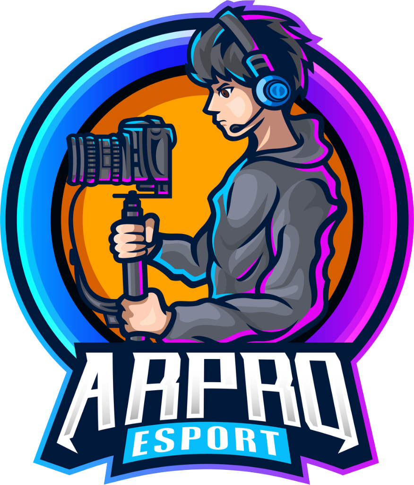
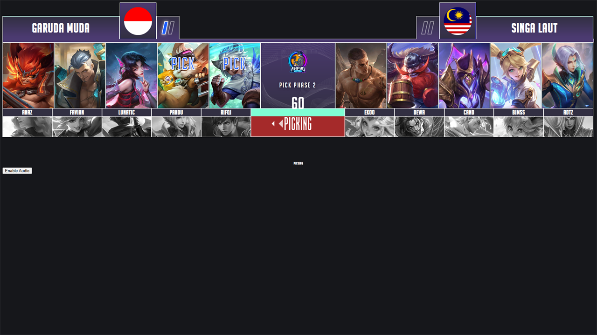
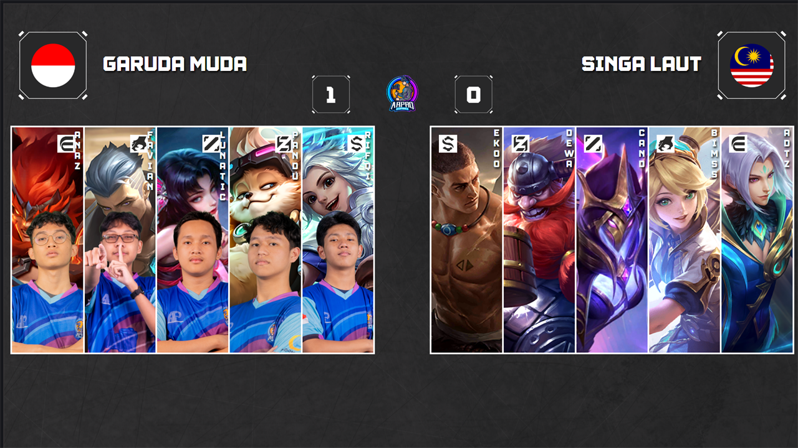
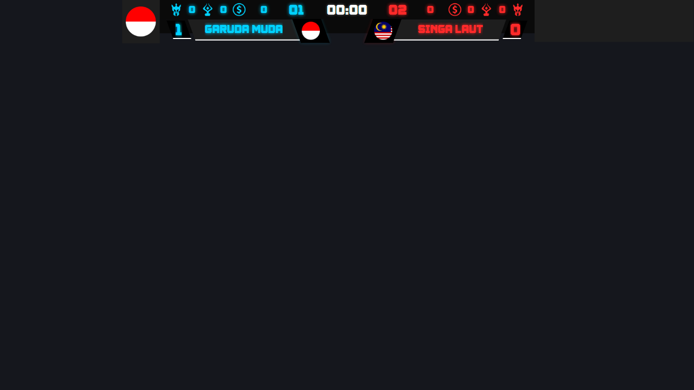
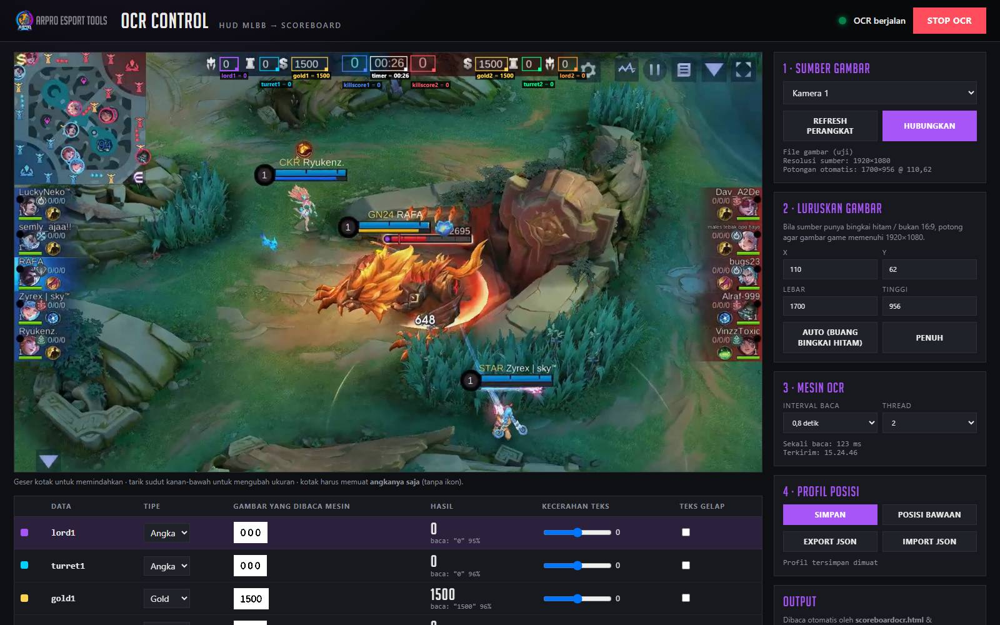
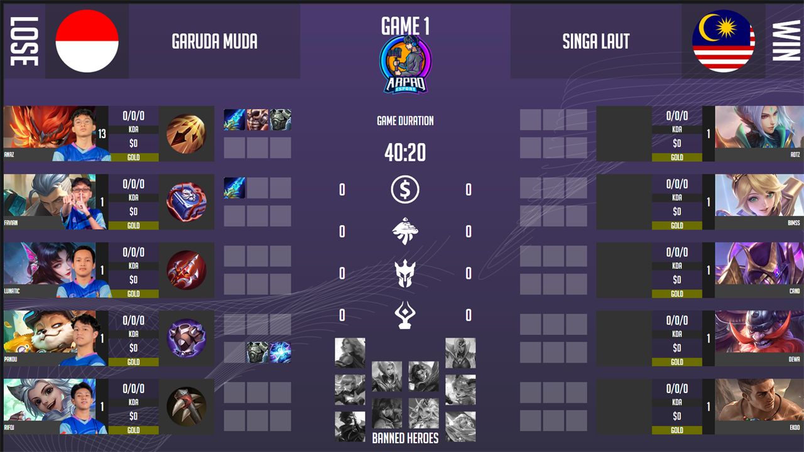
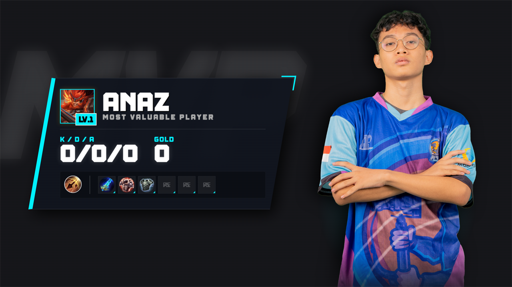

<div align="center">



# ARPRO MLBB Overlay Tool & OCR

**Tool overlay broadcast Mobile Legends: Bang Bang. Draft pick/ban, scoreboard, postgame, dan OCR gameplay realtime, siap dipakai di OBS & vMix.**


Dikembangkan oleh **CV. Arindra Production** × **ARPRO Esport**

</div>

---

## ✨ Fitur Utama

| | Fitur | Keterangan |
|---|---|---|
| 🎯 | **Draft Pick & Ban** | Mode ban 4 / ban 6 dengan beberapa varian tampilan (standar, v2, custom), efek animasi, dan previous draft. |
| 📊 | **Scoreboard** | Scoreboard manual, scoreboard custom, dan scoreboard otomatis dari **OCR**. |
| 🔍 | **OCR Gameplay** | Membaca HUD MLBB langsung dari HDMI capture / webcam / layar: kill, gold, turret, lord, timer. Tanpa OBS, berjalan di browser (Tesseract.js). |
| 📡 | **Output vMix** | Hasil OCR tersedia sebagai JSON untuk **vMix Data Sources** (`/ocr/vmix.json`). |
| 💰 | **Gold Lead & Grafik Gold** | Bar selisih gold realtime dan grafik selisih gold sepanjang game (ala MPL), langsung dari OCR. |
| ⏱️ | **Timer Turtle & Lord** | Hitung mundur spawn objektif dari timer game. Video Turtle/Lord Spawn diputar otomatis. |
| ⚡ | **Notifikasi Otomatis** | First Blood & Lord Slain otomatis dari OCR, plus saran Double/Triple/Maniac/Savage yang tinggal diklik operator. |
| 📈 | **Statistik Hero** | Most picked / most banned / presence + win rate hero sepanjang turnamen. |
| 🥇 | **Leaderboard Pemain** | Top KDA, kills, assists, MVP terbanyak, avg gold, dan hero andalan tiap pemain. |
| 🗂️ | **Klasemen & Bracket** | Klasemen otomatis per grup (match W-L, game W-L, selisih) dan bracket playoff 4/8/16 tim. |
| ⚔️ | **Head-to-Head** | Perbandingan dua tim yang sedang main: rekor, win rate, rata-rata kill & durasi, hero andalan. |
| 🔦 | **Draft Spotlight** | Kartu otomatis tiap pick/ban: statistik hero di turnamen, FIRST APPEARANCE, pemain yang memilih + hero pool-nya. |
| 🪪 | **Kartu Profil** | Profil pemain / tim (KDA, MVP, win rate, hero pool, roster) yang dipilih operator. |
| 🔁 | **Series Recap** | Rekap tiap game dalam BO: pick, pemenang, durasi, MVP, kill, grafik gold. |
| 🏅 | **Rekor & Milestone** | Popup otomatis: kill terbanyak, game tercepat/terlama, perfect game, MVP ke-N, kemenangan pertama. |
| 🎛️ | **Stream Deck / Companion** | Satu URL per tombol: notifikasi, MVP, lineup, skor, pemenang, simpan hasil game. |
| 🏆 | **Postgame & MVP** | Statistik pasca-pertandingan, tampilan MVP, dan build/item hero. |
| 📅 | **Schedule & Lineup** | Jadwal pertandingan, lineup pemain, dan undian/drawing grup. |
| 🔔 | **Notifikasi & Event** | Notifikasi on-air dan event notification (first blood, savage, dll). |
| 🌐 | **Multi-PC (LAN)** | Satu server, banyak operator. Semua halaman tersinkron realtime lewat WebSocket. |

## 📸 Tampilan

| Draft | Postdraft |
|---|---|
|  |  |
| **Scoreboard OCR** | **OCR Control** |
|  |  |
| **Postgame** | **MVP** |
|  |  |

> Screenshot semua halaman ada di [`public/Assets/screenshots`](public/Assets/screenshots).

## 🚀 Instalasi

**Kebutuhan:** Windows 10/11 dan [Node.js](https://nodejs.org) 18 atau lebih baru.

```bash
git clone https://github.com/rezaarindra/ARPRO-MLBB-Overlaytool-OCR-Tools.git
cd ARPRO-MLBB-Overlaytool-OCR-Tools
npm install
```

> **Font:** lisensi font *Big Noodle Titling* (Sentinel Type) tidak mengizinkan file font diunggah ulang. Unduh gratis dari situs Sentinel Type / dafont, lalu taruh `big_noodle_titling.ttf` dan `big_noodle_titling_oblique.ttf` di `public/Assets/Font/` (dan salin `big_noodle_titling.ttf` ke `public/Assets/costum/Theme/`).

### Menjalankan

- **Cara mudah:** klik dua kali **`ARPROESPORTTOOLS.BAT`**. IP LAN terdeteksi otomatis, lalu server jalan dan Command Center terbuka di browser.
  - Kalau IP yang terdeteksi salah (VPN/VMware), pakai **`ARPROESPORTTOOLS_FIXIP.bat`**.
- **Manual:**
  ```bash
  npm start
  ```
  Lalu buka `http://localhost:3000/hub.html`.

Jangan tutup jendela server selama siaran berlangsung.

## 🖥️ Halaman

Semua halaman bisa dibuka dari **Command Center** (`/hub.html`).

| Jenis | Halaman |
|---|---|
| **Control** (operator) | `control.html`, `controlban6.html`, `costumoverlaycontrol.html`, `drawcontrol.html`, `notifcontrol.html`, `postgamecontrol.html`, `schedulecontrol.html`, `ocrcontrol.html` |
| **Display** (Browser Source / vMix) | `display.html`, `display2.html`, `displaycostum.html` (+ versi `ban6`), `postdraft*.html`, `scoreboard*.html`, `previousdraft.html`, `notifdisplay.html`, `builds.html`, `globalban.html`, `lineupdisplay.html`, `ingamedisplay.html`, `eventdisplay.html` |
| **Utility** | `postgame.html`, `mvpdisplay.html`, `scheduledisplay.html`, `drawdisplay*.html`, `drawfinal.html` |

Untuk OBS: tambahkan **Browser Source** dengan URL `http://IP-SERVER:3000/<halaman>.html`, ukuran 1920×1080.

## 🔍 OCR Gameplay


1. Buka `http://localhost:3000/ocrcontrol.html` **di PC server**. Kamera/capture hanya diizinkan browser di `localhost`, jadi halaman ini akan otomatis dialihkan ke sana.
2. Pilih sumber video: HDMI capture, webcam, atau layar.
3. Atur kotak HUD (kill, gold, turret, lord, timer) di atas pratinjau, lalu klik **Simpan** profil posisi.
4. Tekan **START**. Hasilnya langsung dipakai oleh `scoreboardocr.html` dan `scoreboardcostumocr.html`.

### Gold Lead, Timer Objektif & Notifikasi Otomatis

Selama OCR berjalan, server otomatis menghitung selisih gold, jadwal Turtle/Lord, dan mendeteksi kill/lord.

| Overlay | Isi | Opsi URL |
|---|---|---|
| `goldlead.html` | Bar selisih gold + chip timer Turtle/Lord (menyala menjelang spawn) | `?x=960&y=104` posisi · `&scale=1.2` · `&objectives=0` · `&bar=0` |
| `goldgraph.html` | Grafik selisih gold sepanjang game + penanda First Blood & Lord | `?x=960&y=540` · `&scale=0.8` |

Atur di **OCR Control → 5 · Otomasi & Gold**:
- **First Blood otomatis**: kill pertama game → video First Blood.
- **Lord Slain otomatis**: angka lord di HUD naik → video Blue/Red Lord Slain + timer respawn Lord.
- **Turtle / Lord Spawn otomatis**: video spawn diputar tepat waktunya (default Turtle 2:00, Lord 8:00, respawn 2:00; bisa diubah sesuai patch).
- **Saran multikill**: kill beruntun satu tim dalam jendela waktu → muncul tombol **TAYANG** (operator yang memutuskan, karena OCR tidak tahu pemain mana yang membunuh).
- Turtle tidak terbaca dari HUD: tekan **Blue/Red Turtle Slain** di Notif Control untuk memulai timer respawn turtle.
- Data game di-reset otomatis saat timer game kembali ke awal (game baru), atau manual lewat tombol **RESET GAME**.

Video notifikasi tampil di `notifdisplay.html`, jadi pastikan halaman itu terpasang di OBS/vMix.

### Endpoint Data OCR

| Endpoint | Fungsi |
|---|---|
| `GET /ocr/MLBB.json` | Data OCR terbaru. Membalas 404 kalau OCR tidak berjalan lebih dari 15 detik. |
| `GET /ocr/vmix.json` | Khusus **vMix**: selalu 200, kolom selalu lengkap, nilai terakhir dipertahankan, plus kolom `status` (`LIVE` / `STALE` / `OFF`). |
| `GET /api/ocr/game` | Analitik game: gold terkini & riwayat grafik, selisih gold, jadwal Turtle/Lord, penanda, saran multikill. |

### Integrasi vMix

1. vMix → **Settings → Data Sources → Add → JSON**
2. URL: `http://IP-SERVER:3000/ocr/vmix.json`
3. Set refresh interval sekecil mungkin (sekitar 1 detik).
4. Hubungkan field title GT ke kolom: `killscore1`, `killscore2`, `gold1`, `gold2`, `turret1`, `turret2`, `lord1`, `lord2`, `timer`.

> Tips siaran: biarkan tab OCR Control tetap terbuka dan aktif (jangan di-minimize), dan pakai LAN kabel.

## 🏆 Statistik Turnamen

Semua statistik dihitung otomatis dari **hasil game yang disimpan**.

1. Setelah game selesai, isi KDA/gold/item dan pilih **BLUE WIN / RED WIN** di **Postgame Control**.
2. Tekan **SIMPAN KE TURNAMEN** (di Postgame Control atau **Tournament Control**). Simpan ulang game yang sama (tim & nomor game sama) = koreksi, bukan game baru.
3. Game antar dua tim yang sama otomatis dikelompokkan jadi satu **series** sesuai format BO yang aktif.

| Overlay | Isi | Opsi URL |
|---|---|---|
| `herostats.html` | Most picked, most banned, highest presence + pick/ban/win rate | `?top=5` |
| `leaderboard.html` | 4 papan ringkas (KDA, kills, MVP, avg gold) | `?stat=kda\|kills\|assists\|mvp\|gold` (daftar detail) · `&min=2` |
| `standings.html` | Klasemen: match W-L, game W-L, selisih, win% | `?group=A` · `&advance=4` |
| `bracket.html` | Bracket playoff, pemenang maju otomatis | diatur di Tournament Control |
| `h2h.html` | Head-to-head tim biru vs merah yang sedang main | `?a=TIM&b=TIM` |
| `draftspotlight.html` | Kartu otomatis tiap pick/ban (statistik hero + pemain yang memilih) | `?hold=5` · `&bans=0` · tes: `?demo=fanny&side=blue&slot=0` |
| `profile.html` | Kartu profil pemain / tim, dipilih di Tournament Control › Kartu Profil | `?type=player&name=Anaz` (kartu tetap) |
| `seriesrecap.html` | Rekap series BO yang sedang dimainkan | `?a=TIM&b=TIM` |
| `milestone.html` | Popup rekor & milestone saat hasil game disimpan | `?hold=6` · tes: `?demo=1` |

Semua overlay: latar transparan, `?x=&y=` (posisi tengah panel), `&scale=`, `&bg=green|dark`.
Nama turnamen, grup tim, bracket, dan daftar/hapus game diatur di **`tournamentcontrol.html`**.

## 🎛️ Stream Deck / Bitfocus Companion

Buka **`companion.html`** untuk daftar lengkap URL (tombol **COPY** & **TES**). Di Companion pakai modul **Generic: HTTP Requests** → aksi **GET**:

```
http://IP-SERVER:3000/api/companion/notif/firstblood
http://IP-SERVER:3000/api/companion/score/blue/up
http://IP-SERVER:3000/api/companion/mvp-show?side=red&slot=2
http://IP-SERVER:3000/api/companion/save-result
```

## ⚙️ Konfigurasi (opsional)

| File | Fungsi |
|---|---|
| `github_config.json` | Untuk fitur **Sync Asset dari GitHub**. Salin dari [`github_config.example.json`](github_config.example.json) lalu isi token sendiri. **Jangan pernah commit file ini.** |
| `ssc_config.json` | Feed lineup eksternal (SSC). |
| `public/database/*.json` | Data tim, draft, jadwal, tema, dll. Diubah lewat halaman control. |

## 📁 Struktur Folder

```
├── server.js                 # Server Express + WebSocket (port 3000)
├── ARPROESPORTTOOLS.BAT      # Launcher Windows
├── public/
│   ├── hub.html              # Command Center
│   ├── *control.html         # Halaman operator
│   ├── *display*.html        # Halaman overlay (on-air)
│   ├── script/               # Logika front-end (draft, OCR engine, dll)
│   ├── database/             # Data JSON
│   ├── vendor/tesseract/     # Engine OCR (Tesseract.js)
│   └── Assets/               # Hero, item, map, font, logo, voice line
└── mock/                     # Data contoh untuk testing feed
```

## 📜 Lisensi & Kredit

Kode sumber dirilis di bawah **[MIT License](LICENSE)**. © 2026 **CV. Arindra Production** & **ARPRO Esport**.

- *Mobile Legends: Bang Bang* serta seluruh artwork hero, ikon, map, dan voice line adalah milik **Moonton**. Konten tersebut tidak termasuk dalam lisensi MIT dan disertakan hanya untuk keperluan tool broadcast non-komersial.
- OCR memakai [Tesseract.js](https://github.com/naptha/tesseract.js) (Apache 2.0).
- Proyek ini tidak berafiliasi dengan maupun didukung oleh Moonton.

<div align="center">

---

**CV. Arindra Production** × **ARPRO Esport**

*Made with 💜 for the Indonesian esports community*

</div>
